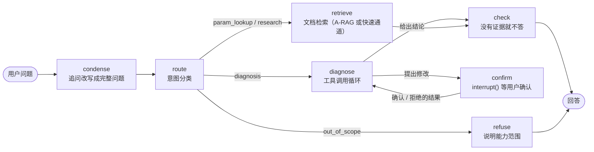

# TiDB 运维诊断助手：架构

阶段 6 的主 Agent。代码在 `research_agent/assistant/`，配置 `configs/assistant.yaml`，设计取舍见 design_decisions.md D31。

## 主图

一轮对话是 LangGraph 主图的一次运行；同一会话是检查点里的同一个 thread。



| 节点 | 模型 | 做什么 |
| --- | --- | --- |
| `condense` | router（qwen3.7-flash） | 有历史时，把“那这个参数在 v8.1 里呢？”改写成不看前文也能懂的问题；没有历史时不调用模型 |
| `route` | router | 分成参数查询、跨文档研究、故障诊断、越界四类；输出不合法时按“研究”处理 |
| `retrieve` | A-RAG 的 Agent（qwen3.7-plus） | 由 `Services.choose_channel(question, intent)` 选通道：A-RAG 多轮检索，或普通 RAG（要求引用，D29）。`fast_intents` 中的意图走普通 RAG；阶段 7 的对比显示参数查询走快通道准确率低 14 个百分点且不省钱，默认为空，即全部走 A-RAG（D32） |
| `diagnose` | agent（qwen3.7-plus） | 工具调用循环，最多 12 步。开放给诊断的 19 个工具（见下文工具清单）都经过 `ToolHarness`；工具在本进程内执行，或经 MCP server 执行（`tool_source`）。查到能解释症状的证据就停；最后两步提醒收尾；步数用完时给出“目前的结论 + 还缺什么”（D38） |
| `confirm` | — | 用 `interrupt()` 暂停整张图，等用户确认或拒绝；确认才执行，结果作为工具结果交还诊断循环 |
| `check` | — | 回答背后没有证据（没有读过或看过片段的引用块，也没有集群数据）就拒答；诊断时集群连不上则明确说明。A-RAG 的回答没写块编号时，用它完整读过的块作为依据（D32） |
| `refuse` | — | 越界问题，说明能做什么 |

## 数据流

```mermaid
flowchart TB
    subgraph 入口
        cli["CLI<br/>python -m research_agent.assistant"]
        demo["Streamlit 演示<br/>apps/chat_demo.py"]
    end
    app["AssistantApp（app.py）<br/>组装服务、串行化、写轨迹"]
    graph["Assistant（graph.py）<br/>主图 + 事件流"]
    cli --> app
    demo --> app
    app --> graph
    graph --> docs["DocRetriever（retrieval.py）<br/>A-RAG / 普通 RAG"]
    graph --> ro["ReadOnlyTools<br/>agent_ro 账号"]
    graph --> wt["WriteTools → WriteExecutor<br/>root 账号，只在确认后"]
    docs --> index[("TiDB 中文文档索引<br/>579 块，v8.1 + v8.5")]
    ro --> tidb[("本地 TiDB v8.5.8<br/>tiup playground")]
    wt --> tidb
    wt --> audit[("writes.jsonl 审计")]
    graph --> ckpt[("sessions.sqlite<br/>会话检查点")]
    app --> trace[("traces/会话.jsonl")]
```

- **会话**：检查点存在 SQLite（`data/assistant/sessions.sqlite`），`history` 字段按轮追加，追问能看到上文；等待确认的修改也存在检查点里，进程重启后仍能确认。
- **事件流**：节点通过 LangGraph 的 stream writer 发出事件，`Assistant` 再把 `interrupt` 转成 `confirm_required`，最后补一个 `done`。事件类型：`route`、`retrieval_start`、`tool_call`、`tool_result`、`confirm_required`、`answer`、`error`、`done`。阶段 9 的 SSE 接口直接转发这些事件。
- **轨迹**：`AssistantApp` 把每个事件和每次文档检索的完整步骤追加到 `data/assistant/traces/<会话>.jsonl`，可以事后复盘。
- **花费**：每个节点把模型花费累加到状态的 `cost`，随 `answer` 事件返回。

## 服务（阶段 9，D36）

`research_agent/service/app.py`：FastAPI 提供 `POST /chat`、`POST /chat/stream`（SSE）、`POST /chat/confirm`、`GET /sessions/{id}`、`GET /health`。每轮对话由一个工作线程驱动助手的事件生成器，事件经队列交给请求。

- 同一会话同时只允许一轮，总共最多接纳 `MAX_ACTIVE_TURNS` 轮；
- 诊断循环到 `turn_timeout_s` 自行停止，服务层另有 `REQUEST_TIMEOUT_S` 硬超时；
- 步数用完时再调用一次模型，根据已有证据给出结论。

演示页设置 `CHAT_DEMO_API_URL` 后通过 HTTP 调用服务（`research_agent/service/client.py`）。

## 工具清单（阶段 10–11，D37、D38）

工具注册表 `research_agent/toolkit/specs.py` 给每个工具标明类别、权限级别和开放给哪些意图。“开放给”指模型在这类问题中能看到并调用它。

| 工具 | 类别 | 权限 | 开放给 | 说明 |
| --- | --- | --- | --- | --- |
| `search_docs` | 文档 | 只读 | 参数查询、研究、诊断 | 整个 A-RAG 作为一个工具，返回带引用的回答；每轮最多 2 次 |
| `run_sql` | 集群 | 只读 | 诊断 | 只读 SQL（SELECT / SHOW / EXPLAIN / DESC），语句检查 + 只读账号 |
| `show_variables` | 集群 | 只读 | 诊断 | 系统变量的全局值 |
| `slow_queries` | 集群 | 只读 | 诊断 | 慢查询日志（`cluster_slow_query`） |
| `explain` | 集群 | 只读 | 诊断 | 执行计划，可选 `EXPLAIN ANALYZE`（只允许 SELECT） |
| `lock_waits` | 集群 | 只读 | 诊断 | 悲观锁等待，含持锁会话和它执行过的语句 |
| `transactions` | 集群 | 只读 | 诊断 | 正在运行的事务 |
| `deadlocks` | 集群 | 只读 | 诊断 | 最近的死锁 |
| `statement_summary` | 集群 | 只读 | 诊断 | 总耗时最多的语句 |
| `table_stats` | 集群 | 只读 | 诊断 | 统计信息的修改行数和健康度 |
| `table_schema` | 集群 | 只读 | 诊断 | 表结构和索引 |
| `bindings` | 集群 | 只读 | 诊断 | 全局 SQL 绑定 |
| `cluster_info` | 集群 | 只读 | 诊断 | 各组件版本和运行时间 |
| `search_logs` | 日志 | 只读 | 诊断 | 检索 tidb / tikv / pd 日志的最新匹配行（读本机 tiup 数据目录） |
| `show_config` | 配置 | 只读 | 诊断 | `SHOW CONFIG`，用只有 CONFIG 权限的独立账号，只发一条固定的参数化语句 |
| `export_report` | 报告 | 只读（只写本地文件） | 诊断 | 把诊断整理成 Markdown 报告保存到本地 |
| `propose_set_global` | 写操作 | 需确认 | 诊断 | 只生成 `SET GLOBAL` 语句、影响说明和回滚语句 |
| `propose_analyze` | 写操作 | 需确认 | 诊断 | 只生成 `ANALYZE TABLE` 语句和影响说明 |
| `propose_create_index` | 写操作 | 需确认 | 诊断 | 只生成 `CREATE INDEX` 语句和影响说明 |
| `execute_write` | 写操作 | 禁止 | 无 | 只登记在注册表里，用来识别并拒绝这类调用；写操作只在 `confirm` 节点经用户确认后执行 |
| `keyword_search`、`semantic_search`、`read_chunk` | 文档（A-RAG 内部） | 只读 | 参数查询、研究（经文档通道），以及 `search_docs` 内部 | A-RAG 的分层检索工具，由 A-RAG 自己的 Agent 循环调用，不经过 harness |

**按意图开放**：
- 参数查询和研究类走文档通道，A-RAG 的模型只看到上面最后一行的 3 个检索工具；
- 诊断类看到 19 个工具（不含 `execute_write`）；
- 越界类不调用任何带工具的模型。

工具定义的 token 数见 `docs/results/stage11_tool_tokens.md`。

## Harness：一次请求经过的各层

```mermaid
flowchart TB
    http["HTTP / SSE（service）<br/>每会话一轮、并发上限、硬超时"] --> app["AssistantApp<br/>串行执行一轮、写轨迹"]
    app --> graph["LangGraph 主图<br/>改写追问 → 意图分类"]
    graph --> loop["诊断循环<br/>步数上限、单轮截止时间、收尾提醒"]
    loop --> harness
    subgraph harness["ToolHarness（toolkit/harness.py）"]
        direction TB
        perm["权限：未知 / 禁止 / 不对该意图开放 → 拒绝"] --> valid["参数校验：必填、类型、枚举、范围、默认值"]
        valid --> budget["每轮预算：总调用次数、文档检索次数"]
        budget --> dup["重复调用：直接返回上次结果，不再执行；修改提议不重复提出"]
        dup --> timeout["超时：按工具设置"]
        timeout --> backend["后端：进程内 / MCP stdio"]
        backend --> trunc["结果截断：按工具设置的长度"]
        trunc --> audit["审计日志：每次调用一行"]
    end
    harness --> loop
    loop -- "修改提议" --> confirm["confirm 节点：interrupt() 等用户确认<br/>确认后用管理员账号执行，写入写操作审计"]
    confirm --> loop
    loop --> check["证据检查"] --> answer["answer 事件 → SSE"]
```

1. **服务层**：同一会话同时只允许一轮，总共最多接纳 `MAX_ACTIVE_TURNS` 轮，另有硬超时（D36）。
2. **`AssistantApp`**：一轮一轮串行执行，记录事件和每次文档检索的轨迹。
3. **主图**：先改写追问、分类意图；参数查询和研究走文档通道，诊断进入诊断循环，越界直接回答。
4. **诊断循环**（D38）：
   - 每轮开始时清零 harness 的预算；
   - 每步之前检查单轮截止时间；
   - 剩下最后两步时，在工具结果末尾提醒尽快收尾；
   - 步数用完时，再调用一次不带工具的模型，给出“目前的结论 + 还缺什么”。
5. **`ToolHarness`**：每次工具调用依次经过权限、参数校验、预算、去重、超时、后端执行、截断，最后写一行审计日志（`data/assistant/tool_calls.jsonl`）。同类逻辑原来分散在诊断循环和各个工具里，现在统一放在这一层。
6. **`confirm` 节点**：修改提议在这里暂停整张图，用户确认后由 Agent 进程用管理员账号执行，写入写操作审计（`data/assistant/writes.jsonl`）。执行结果交还诊断循环，并提醒模型给出完整结论。
7. **证据检查**：回答背后没有证据就拒答，然后发出 `answer` 事件，经 SSE 返回。

## MCP（阶段 10，D37）

`python -m research_agent.toolkit.mcp_server` 用 MCP 官方 Python SDK（2.x 低层 `Server`）通过 stdio 提供工具：开放除 `execute_write` 以外的全部 19 个工具。

- 3 个 `propose_*` 只返回语句、影响说明和回滚语句（`structuredContent` 中的 PendingWrite）。
- MCP server 进程不建管理员连接，所以任何调用方都不能经 MCP 执行写操作。
- Agent 设置 `tool_source: mcp` 后，以子进程方式启动这个 server，由 `McpTools` 后端代替进程内后端；harness、确认和执行都不变。

## 安全边界

| 层 | 措施 |
| --- | --- |
| 数据库权限 | 只读工具用 `agent_ro` 账号连接，只有 `shop.*` 的 SELECT 和全局 PROCESS 权限（`research_agent/tidb/setup.py`）；即使 SQL 检查被绕过，也写不了数据 |
| SQL 检查 | 自由 SQL 只允许 SELECT / SHOW / DESC / EXPLAIN，拒绝多语句和写关键字；`EXPLAIN ANALYZE` 只允许跟 SELECT（会真正执行） |
| 执行限制 | 会话级 `max_execution_time`（默认 10 秒），结果最多 200 行 |
| 修改 | 模型只能调用 `propose_*` 生成待确认的修改（语句、影响说明、回滚语句）；只有用户确认后 `WriteExecutor` 才用管理员账号执行，每次决定都写审计日志 |
| 一次一项 | 一轮里只接受第一项修改提议，其余的告诉模型等确认后再提 |
| 配置读取 | `SHOW CONFIG` 需要 CONFIG 权限，而它也允许 `SET CONFIG`；所以用单独的 `agent_cfg` 账号（只有 CONFIG 权限，读不了也写不了任何表），工具只发一条固定的参数化语句（D37） |
| 工具调用 | 所有调用经过 harness：禁止级和不对当前意图开放的工具直接拒绝；修改提议去重，不会重复提出（D38） |
| MCP | MCP 只开放只读和“提议”类工具，server 不建管理员连接；写操作只在 Agent 的 `confirm` 节点执行（D37） |

## 运行

```bash
python -m research_agent.assistant --session demo-1 "tidb_mem_quota_query 的默认值是多少？" "那这个参数在 v8.1 里的默认值呢？"
```

```bash
uv run streamlit run apps/chat_demo.py
```

集群（阶段 5，需要先安装 tiup）：`python -m research_agent.tidb start`、`setup`、`verify`。集群没启动时，助手照常回答文档问题，诊断问题会说明连不上集群。

## 一次真实对话（2026-11-03，会话 `demo-1`，没有集群）

| 轮 | 问题 | 路由 | 结果 | 耗时 | 花费（元） |
| --- | --- | --- | --- | ---: | ---: |
| 1 | tidb_mem_quota_query 的默认值是多少？ | 参数查询 | 1 GB，答案正确，但引用的是 explain-joins.md，引用偏弱 | 13.7 s | 0.0117 |
| 2 | 那这个参数在 v8.1 里的默认值呢？ | 参数查询 | 改写为“tidb_mem_quota_query 在 TiDB v8.1 版本中的默认值是多少？”，引用 Chunk 408，1073741824 | 31.9 s | 0.0313 |
| 3 | 与 v8.1.0 相比，v8.5.8 中哪些 TiKV 配置项的默认值发生了变化？ | 跨文档研究 | 列出 v8.4 等版本的 TiKV 默认值变更 | 127.9 s | 0.2172 |
| 4 | 今天北京天气怎么样？ | 越界 | 说明能力范围 | 2.7 s | 0.0002 |
| 5 | 我的订单查询突然变慢了，帮我看看 | 故障诊断 | 没有集群，拒答（之后改为专门说明集群连不上） | 15.5 s | 0.0089 |

共 0.27 元。跨文档研究一轮 128 秒，是阶段 7 分流要解决的问题之一。
