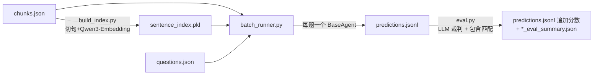
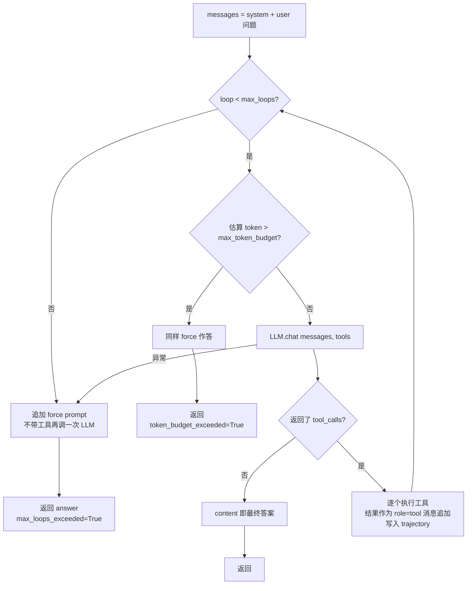

# A-RAG 代码解读

> 基于上游 commit `a44de6b`（2026-10-30 fork 时的版本）。行号以此版本为准。
> 本文只描述 A-RAG 原有代码；我们新增的包装层见文末“扩展点”一节和 `research_agent/`。

## 1. 一句话概括

A-RAG 把检索做成三个**工具**交给 LLM：`keyword_search`（关键词）、`semantic_search`（句子级向量）、`read_chunk`（读全文）。LLM 在一个 ReAct 循环里自己决定先搜什么、读哪块、什么时候停止作答。和普通 RAG 的区别是：普通 RAG 是“程序检索一次 → 塞给模型”，A-RAG 是“模型自己多轮检索”。

整个仓库只有约 1800 行 Python，结构很薄：

```
src/arag/
├── core/
│   ├── config.py      # Config：YAML/JSON → 嵌套 dict，支持 "a.b.c" 取值（66 行）
│   ├── context.py     # AgentContext：单个问题内的状态（读过哪些块、检索了多少 token）
│   └── llm.py         # LLMClient：OpenAI 兼容 /chat/completions 的 requests 封装 + 按 USD 计费
├── agent/
│   ├── base.py        # BaseAgent：ReAct 主循环（全仓库最核心的 120 行）
│   └── prompts/default.txt  # 系统提示词（20 行）
└── tools/
    ├── base.py        # BaseTool 抽象类：name / get_schema / execute
    ├── registry.py    # ToolRegistry：按名字注册、导出 schema、分发执行
    ├── keyword_search.py
    ├── semantic_search.py
    └── read_chunk.py
scripts/
├── build_index.py     # 离线：切句 → 嵌入 → pickle
├── batch_runner.py    # 批量跑题：多线程 + 断点续跑
└── eval.py            # 评测：LLM 裁判 + 包含匹配
```

## 2. 数据格式

| 文件 | 格式 | 说明 |
| --- | --- | --- |
| `data/<ds>/chunks.json` | `["0:text...", "1:text...", ...]` | 每个元素是 `"id:正文"` 字符串。MuSiQue 有 1354 块，**正文全部小写** |
| `data/<ds>/questions.json` | `[{"id","question","answer",...}]` | MuSiQue 1000 题，id 前缀标明跳数（`musique_2hop__...`） |
| `data/<ds>/index/sentence_index.pkl` | dict：`sentences`、`embeddings`(N×1024, 已归一化)、`sentence_to_chunk`、`chunks` | `build_index.py` 产物。MuSiQue：50,767 句，211 MB |

块本身由数据集提供（约 1000 token/块，论文 4.1 节），A-RAG 不负责切块。`build_index.py` 只做**块内切句**：`re.split(r'[.!?\n]+')`，并丢掉 ≤10 字符的句子（[build_index.py:23-26](../scripts/build_index.py:23)）。这个正则会把 `3.5`、`U.S.` 这类内容切断，会影响句子级检索质量。

## 3. 端到端流程



`batch_runner.py` 的要点（[scripts/batch_runner.py](../scripts/batch_runner.py)）：
- `_init_shared_tools`（:65）：三个工具只初始化一次、所有线程共享，嵌入模型只加载一次。**如果索引文件不存在，`semantic_search` 会被静默跳过**（只打印 warning）。
- `_create_agent`（:134）：每题新建一个 `LLMClient` + `BaseAgent`。注意它**只把 `reasoning_effort` 从配置传给 LLMClient**，`llm.temperature` 和 `llm.max_tokens` 配置项被忽略，实际使用 LLMClient 的默认值（0.0 / 16384）；`max_loops` 默认值是 10，而 `configs/example.yaml` 写的是 15。
- `_process_one`（:156）：调用 `agent.run()`，把结果整理成一行 JSON。它**丢掉了** `max_loops_exceeded` / `token_budget_exceeded` 两个标志，也不记录 token 数和耗时。
- `run`（:194）：按 `qid` 断点续跑，`ThreadPoolExecutor` 并发，每完成一题追加写一行（加锁）。

## 4. Agent 主循环（[src/arag/agent/base.py](../src/arag/agent/base.py)）



逐段说明：

1. **初始化**（:67-82）：每次 `run` 新建一个 `AgentContext`，消息只有 system + user 两条。工具 schema 每次 `chat` 都随请求发送。
2. **token 预算检查**（:86-104）：用 tiktoken 的 gpt-4o 分词器估算当前 messages 的 token 数（[`_calculate_message_tokens`](../src/arag/agent/base.py:33)）。这是一个**近似值**：只统计 `content`，不含 `tool_calls` 的参数 JSON 和工具 schema，且分词器不是 Qwen 的。默认预算 128K，实际很少触发。
3. **调用 LLM**（:108-117）：`self.llm.chat(messages, tools)`。返回的 assistant message **原样**追加回 messages（包括 `tool_calls` 字段），这是 OpenAI 工具调用协议要求的。
4. **终止判断**（:122-131）：没有 `tool_calls` 就把 `content` 当作最终答案返回。也就是说“停止”完全由模型决定，没有显式的 `finish` 工具。
5. **执行工具**（:134-174）：一条 assistant 消息里可以有多个并行的 `tool_calls`，按顺序逐个执行。参数 JSON 解析失败时**静默变成空参数**（:138-140）。每个结果作为 `{"role":"tool","tool_call_id":...}` 追加。`trajectory` 每个工具调用记一条：`loop`、`tool_name`、`arguments`、`tool_result` 全文，加上工具返回的 log（`retrieved_tokens` 等）。
6. **强制作答**（[`_force_final_answer`](../src/arag/agent/base.py:41)）：追加一条 user 消息“已达上限，必须现在作答，不要再调工具”，然后**不带 tools** 调一次 LLM。

需要注意的行为（后续 bad case 分析会用到）：
- **LLM 调用异常会被吞掉**：`except: break`（:108-113）跳出循环后走“达到最大轮数”的分支，结果里标的是 `max_loops_exceeded=True`。所以上游的结果无法区分“真的超步数”和“API 报错”。我们的 `MeteredLLMClient` 记录了失败调用，借此区分（`termination=llm_error`）。
- **`loops` 统计的是 LLM 调用轮数**，不是工具调用次数。一轮可能调多个工具。
- **模型的中间思考没有进 trajectory**：assistant 消息里的 `content`（工具调用前的推理文字）只存在于局部变量 `messages` 中，`run()` 不返回 messages。阶段 2 要保留完整 messages 做 SFT 数据，必须从外部捕获（见第 8 节）。
- 没有重试、没有单步超时（只有 `requests` 的 300s 超时）。

## 5. 三个检索工具

三者都继承 `BaseTool`，`execute(context, **kwargs)` 返回 `(给模型看的文本, 日志 dict)`，并调用 `context.add_retrieval_log(...)` 记账。

| 工具 | 输入 | 算法 | 返回给模型的内容 | 计入 retrieved_tokens 的部分 |
| --- | --- | --- | --- | --- |
| `keyword_search` ([文件](../src/arag/tools/keyword_search.py)) | `keywords: list[str]`, `top_k=5`（上限 20） | 对每个块做**大小写不敏感的子串计数**，得分 = Σ 出现次数 × 关键词长度（:104-110）；按得分取 top_k | 每块：`Chunk ID` + 含关键词的句子（每块最多 5 句，用 `...` 连接） | 返回的句子片段 |
| `semantic_search` ([文件](../src/arag/tools/semantic_search.py)) | `query: str`, `top_k=5`（上限 20） | 查询编码后与**全部句子向量**点积（暴力检索，:109），取前 `top_k*3` 个句子，按所属块分组，块得分 = 组内最高相似度，取 top_k 块 | 每块：`Chunk ID (Similarity)` + 命中的句子 | 命中的句子 |
| `read_chunk` ([文件](../src/arag/tools/read_chunk.py)) | `chunk_ids: list[str]` | 字典查表 | 块全文；**已读过的块只返回“(This chunk has been read before)”**（:106） | 只算首次读取的块 |

设计意图（论文的“分层检索接口”）：两个 search 工具只返回**片段**，让模型先低成本浏览、判断哪些块相关，再用 `read_chunk` 按需读全文。这就是论文里 A-RAG (Full) 的 retrieved tokens（5,663）远少于只有单一嵌入检索工具的 A-RAG (Naive)（56,360）的原因。

细节：
- 关键词是子串匹配，`"art"` 会匹配 `"start"`；没有 IDF，常见词得分会偏高。
- `semantic_search` 的嵌入编码用一把**类级全局锁**（:30, :106）串行化，多线程跑题时 GPU 编码是排队的。
- 论文里叫 `chunk_read`，代码里的工具名是 `read_chunk`。

## 6. 上下文追踪与成本统计

**`AgentContext`**（[context.py](../src/arag/core/context.py)）是单个问题内的“账本”：
- `read_chunk_ids: set`：读过的块，`read_chunk` 用它去重。
- `retrieval_logs: list[RetrievalLog]` 和 `total_retrieved_tokens`：每次工具调用记一条（工具名、token 数、元数据如 query/命中块）。
- `search_history`：定义了但**没有任何地方使用**。
- `get_summary()` 的结果被展开进 `run()` 的返回值，最终写进 `predictions.jsonl`。

**`retrieved_tokens`** 是论文的效率指标，衡量“检索返回给模型的信息量”，**不是**实际计费的 token。实际计费的输入 token 要大得多：每一轮都会把完整历史（系统提示 + 工具 schema + 所有之前的工具结果）重新发一遍。

**成本**（[llm.py](../src/arag/core/llm.py)）：`LLMClient.calculate_cost`（:100）用响应里的 `usage` 乘以内置的 `PRICING` 表（USD/百万 token），区分缓存命中的输入。模型名用**子串匹配**查表，查不到就用 `default` 价格 (1.0, 0.1, 5.0)。**表里没有任何 Qwen 模型**，所以直接用上游代码跑 Qwen，记录的花费是按默认价格算的美元，数字是错的。`BaseAgent` 把每次调用的 cost 累加成 `total_cost`。

## 7. 评测（[scripts/eval.py](../scripts/eval.py)）

两个指标：
- **LLM-Acc**（`calculate_llm_accuracy`, :71）：让裁判 LLM 比较预测与标准答案，提示词要求“只回答 correct 或 incorrect”。判定条件是 `response.strip().lower() == "correct"`（:94）。如果裁判回 `"Correct."`（带句号），会被判为错。
- **Cont-Acc**（`calculate_contain`, :99）：标准化（小写、去标点、去冠词、合并空格）后，看标准答案是否是预测的**子串**。预测越啰嗦，越容易“包含”。

需要注意：
- **裁判模型就是 `ARAG_MODEL` 环境变量**（:282），默认与 Agent 同一个模型。论文用 GPT-5-mini 当裁判。
- **准确率的分母是“有答案的题数”**（:188），空答案的题不进分母。报错的题（`pred_answer = "Error: ..."`）不是空串，会被当成有答案送去裁判。
- 裁判调用的花费被丢弃（`response, _ = ...`），汇总里的 `total_cost` 只是 Agent 的花费。
- `evaluate` 会**原地改写** `predictions.jsonl`，给每条加上 `llm_accuracy` / `contain_accuracy` / `status`。

## 8. 可以挂接扩展的位置

上游没有回调机制，但类的边界很清楚，以下位置都可以通过继承或包装扩展，不用改源码：

| 扩展需求 | 挂接点 | 我们的做法 / 计划 |
| --- | --- | --- |
| 换模型、改计费、重试、记录每次调用 | 继承 `LLMClient`，覆盖 `chat` / `calculate_cost` | 已完成：`research_agent/llm/client.py` 的 `MeteredLLMClient` |
| 记录每题 token、耗时、终止原因 | 继承 `BatchRunner`，覆盖 `_create_agent` / `_process_one` | 已完成：`research_agent/eval/runner.py` |
| 固定裁判、记录裁判花费 | 用自己的 client 实例化上游 `Evaluator` | 已完成：`research_agent/eval/judge.py` |
| **轨迹记录（阶段 2）** | ① 包装 `LLMClient.chat`：每次调用都能拿到**完整 messages**（同一个 list 对象，逐轮增长）和原始响应；② 包装 `ToolRegistry.execute`：拿到工具名、参数、结果、耗时 | 两者组合即可重建每一步的 thought / tool_call / tool_result / latency / tokens，不需要改 `BaseAgent` |
| 工具消融（阶段 1，已实现） | 构造 `ToolRegistry` 时少注册某个工具 | 已实现：`MeteredBatchRunner._init_shared_tools` 调用 `research_agent/agent/tools.py` 的 `build_tool_registry`，提示词由 `research_agent/agent/prompt.py` 派生（design_decisions.md D11） |
| 新工具（rerank、网络搜索） | 实现 `BaseTool`，`registry.register(...)` | 阶段 5c |
| 规划、记忆（改变循环本身） | 继承 `BaseAgent` 覆盖 `run` | 阶段 5a/5b；`run` 是一个整体方法，没有更细的钩子，覆盖时需要重写循环 |
| 改提示词 | `src/arag/agent/prompts/default.txt` 是文件，可以换成自己的文件传入 `system_prompt` | |

## 9. 已发现的问题清单

按影响从大到小排列，后续阶段会引用：

1. 直接用上游代码跑 Qwen，**成本数字是错的**（价格表没有 Qwen，用的是默认美元价格）。已由 `MeteredLLMClient` 解决。
2. `batch_runner` **忽略配置里的 `temperature` / `max_tokens`**，`max_loops` 默认 10，与示例配置的 15 不一致。我们的 runner 显式传入全部参数。
3. LLM 报错被当作“达到最大轮数”，而且没有重试。已解决：带退避重试，并单独记录 `llm_error`。
4. 裁判严格要求回复恰好是 `correct`；准确率分母不含空答案。我们的 `judge_meta.json` 统计裁判回复的分布，`summary` 同时报告“上游口径”和“全部题目口径”两种准确率。
5. Agent 的完整 messages（含中间推理）不落盘，阶段 2 需要补上。
6. 切句正则会切断小数和缩写；关键词检索是子串匹配，没有 IDF。这两点可能是 bad case 的来源，阶段 4 验证。
7. 查询向量和句子向量用同样的方式编码。Qwen3-Embedding 的模型卡建议查询端加指令前缀（`prompt_name="query"`），上游没有加。这是一个低成本的检索改进点，可以留到阶段 5c 和 rerank 一起评估。
8. `batch_runner` 找不到句子索引时只打印一条警告，然后**静默去掉 semantic_search** 继续跑，完整版会在不知不觉中变成消融版。我们的 `build_tool_registry` 改为直接报错。
